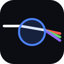

# light refraction

Created in [T3 Code](https://t3.codes).

Open `index.html` in a browser. There is no build step and no server.

Run `node optics.test.js` to check the physics in `optics.js` against textbook results.
