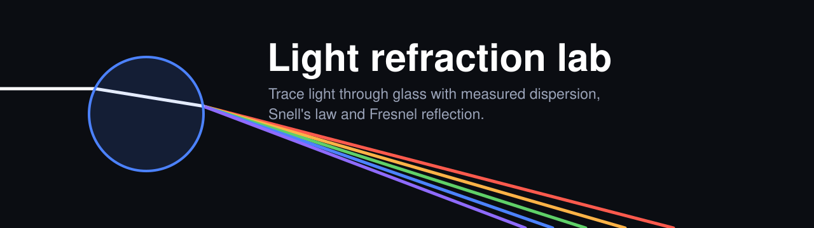
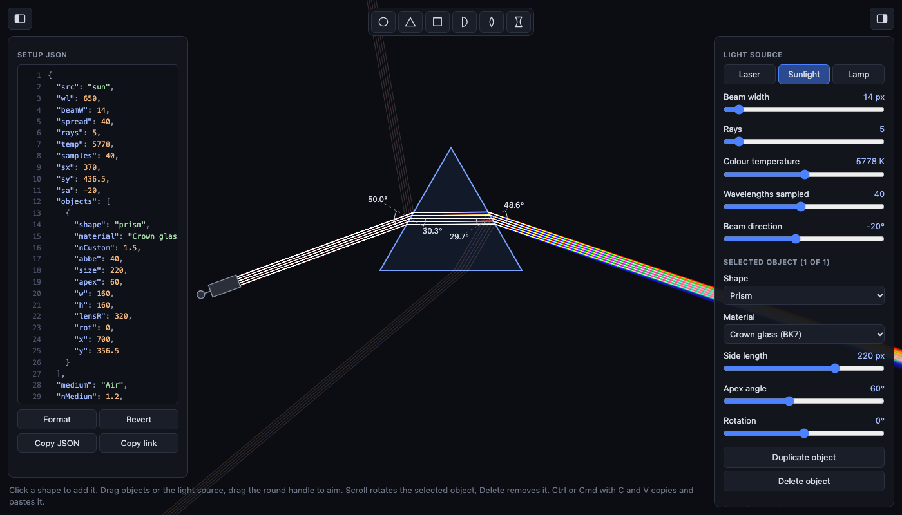

# Light refraction lab

A browser app for learning how light bends through glass. You place glass shapes on a bench, point a light source at them, and the app traces every ray with the same equations an optics textbook uses.



## Run it

Open `index.html` in a browser. There is no build step, no server and no dependency.

## What you can do

- Add objects from the top bar: cylinder, prism, cube, half cylinder, convex lens and concave lens.
- Drag objects and the light source. Drag the round handle behind the source to aim it. Scroll to rotate the selected object.
- Pick a light source: a laser from 380 to 750 nm, sunlight as a parallel white beam, or a lamp as a spreading fan.
- Set each object's material, size and rotation in the right panel. "Custom" material takes a refractive index and an Abbe number.
- Change the surrounding medium, for example a glass prism in water or an air bubble in glass.
- Copy and paste objects with Ctrl or Cmd with C and V. Delete removes the selected object.
- Read the angles of incidence and refraction, the reflected percentage, the critical angle and the total deviation for the reference ray.

## The physics

`optics.js` holds all of it and has no dependency on the page.

- **Refractive index.** Each material uses its published Sellmeier formula, so the index changes with wavelength: BK7 crown glass, SF10 flint glass, fused silica, acrylic, water, diamond and air.
- **Refraction.** Snell's law in vector form at every surface, with total internal reflection past the critical angle.
- **Reflection.** The Fresnel equations split each ray into a reflected and a refracted part, for unpolarised, s or p light.
- **Colour.** White light is a blackbody spectrum. The app traces each sampled wavelength separately and converts it to screen colour with the CIE 1931 colour matching functions.

`node optics.test.js` checks the indices against catalogue values, the prism minimum-deviation formula, Brewster's angle, the critical angle and energy conservation.

## Save and share a setup

The left panel shows the whole scene as JSON and updates as you work. Edit it there and the scene follows as soon as the text parses. The page address carries the same JSON in a `?setup=` parameter, so copying the URL shares the scene.

This setup stacks two half cylinders into an S and crosses two rays of sunlight behind it:

```json
{"src":"sun","beamW":200,"rays":2,"sx":380,"sy":400,"sa":0,
 "objects":[
  {"shape":"half","size":62,"rot":180,"x":613.69,"y":338},
  {"shape":"half","size":62,"rot":0,"x":666.31,"y":462}],
 "refl":false,"angles":false,"gain":6}
```

Any field you leave out keeps its default. The app clamps numbers to the slider ranges and drops fields it does not know.

## Limits

- The scene is a 2D cross-section. There is no 3D view.
- Objects must not overlap. They can touch, but intersecting objects give wrong refraction.
- The app models rays only. It leaves out diffraction, interference and absorption.
- Weak rays draw at their true fraction of the beam's screen value, which looks dim. Raise Exposure to see them.
- Positions are in screen pixels, so a setup made on a large window can land off-screen on a small one.
